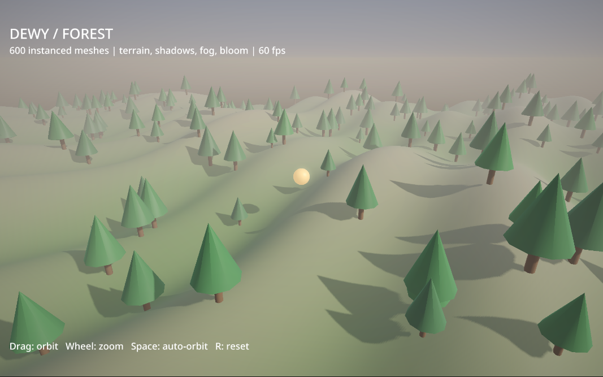

# Dewy on the compact core

Start with [`tour.dewy`](tour.dewy) and the [language guide](../../core/LANGUAGE.md)
for a terminal example of functions, records, copies, comprehensions, Unicode
text, optional values and destructuring. [`entities.dewy`](entities.dewy) adds
user generics, the bundled `Pool<T>` and `Heap<T>`, stable entity handles and a
priority queue of damage events. It shows that removing/replacing an entity does
not redirect old events to the replacement, and that a copied world remains
independent:

```sh
python3 -m tools.core run examples/sloppy_core/entities.dewy
```

```text
Guard health: 75
Snapshot health: 100
Replacement health: 100
Old handle valid: false
```

[`history.dewy`](history.dewy) demonstrates a bounded game-position history.
Its [`ring.dewy`](ring.dewy) module is a generic container written entirely in
Dewy: `push` overwrites the oldest entry when full, `ring[i]` uses its indexing
protocol, and nested assignments write back through its setter. The history
keeps an independent rewind snapshot while editing the current position.

```sh
python3 -m tools.core run examples/sloppy_core/history.dewy
```

The container exposes `new_ring<T>(capacity)`, `.push(value)`, `.len()` and indexing
from oldest to newest. Invalid capacity or indices panic. Use the factory to
construct it; its public storage fields are implementation details. Copying is
cheap until a copy is modified, when ordinary array value semantics apply.

[`exact_integers.dewy`](exact_integers.dewy) uses the bundled `bigint` module to
compute 100!, choose 50 items from 100, perform signed floor division and print
2^256. Its arithmetic and decimal formatting are exact on native and web.

```sh
python3 -m tools.core run examples/sloppy_core/exact_integers.dewy
```

`paddle.dewy` is a playable mouse-controlled paddle game. Its model and drawing
code are Dewy. The pinned Sloppy platform library supplies the window, input,
font, renderer, native frame loop, and WebAssembly browser host.

`physics.dewy` is a larger interactive playground adapted from the pinned Sloppy
physics example: a 57-body scene with a box pyramid, pinned bridge, rope and
wrecking ball. Left-drag a body, right-click to add a box, press B or middle-click
to add a ball, and R to reset. `physics_scene.dewy` contains scene construction
and simulation; the repository-owned `physics` library supplies collision and
joint solving. These programs run natively and in the browser.

`forest.dewy` brings the same workflow to 3D: rolling terrain, 600 instanced tree
meshes, a moving beacon, shadows, fog and bloom. Drag to orbit, use the wheel to
zoom, Space to pause automatic orbit, R to reset and Escape to quit. Terrain
callbacks, placement, camera control and drawing are Dewy; `forest_model.dewy`
keeps deterministic scene construction separate from the window.

After building the compiler as described in `tools/sloppy_core/README.md`:

```sh
CORE=/tmp/dewy-core/bin/dewy-core
# Live editing: save changes and the running game takes the new code.
$CORE watch examples/sloppy_core/paddle.dewy
$CORE watch examples/sloppy_core/physics.dewy
$CORE watch examples/sloppy_core/forest.dewy

$CORE build examples/sloppy_core/paddle.dewy -o /tmp/paddle
/tmp/paddle

# The wasm target emits a self-contained HTML file, including its web runtime.
$CORE build examples/sloppy_core/paddle.dewy --target wasm -o /tmp/paddle
# Open /tmp/paddle.html in a browser.
$CORE build examples/sloppy_core/physics.dewy --release -o /tmp/physics
$CORE build examples/sloppy_core/physics.dewy --target wasm --release -o /tmp/physics
$CORE build examples/sloppy_core/forest.dewy --release -o /tmp/forest
$CORE build examples/sloppy_core/forest.dewy --target wasm --release -o /tmp/forest
```

Use `--release` for the optimizing compiler. The default development build
already runs the game. The current example uses a 1280×720 logical playfield.
The physics playground exercises imported library types, named/default arguments,
mutable receivers, optional handles, tuple results, record copies and rendering.

For display-independent rendering and scripted mouse input:

```sh
SLOPPY_SOFTWARE=1 SLOPPY_SCREENSHOT=/tmp/paddle.png SLOPPY_FRAMES=30 \
  SLOPPY_INPUT=1:mouse=800x620 /tmp/paddle
```

`paddle_model.dewy` has no graphics dependency. The core test suite checks
movement, independent record copies, paddle returns, misses, and paddle limits
on native and WebAssembly targets. It also builds the actual game and exercises
its software renderer. Web execution was separately checked in Chromium,
including mouse input and a rendered frame, with no console errors.

The first native development build reported 150 ms across compiler phases;
the web build reported 97 ms. These are initial observations for this small game,
not repeated build medians. See the restart audit for evidence and limitations.

For a smaller starting point, run `dewy-core new my-game`, then
`dewy-core watch my-game/main.dewy`. The generated README includes native and web
build commands. `dewy-core new my-program program` starts a terminal program.

The physics model gate checks gravity, dragging, joint/body removal and independent
world copies on both targets and in both modes. The browser was also exercised
with mouse/keyboard input and no console errors. A 1,200-step native release
simulation of the 57-body scene took a median 178.32 ms versus 178.64 ms for the
corresponding pinned Sloppy example, compiled with the same owned core and
libraries. Seven alternating measured runs agreed on the position checksum;
setup and drawing were excluded. This demonstrates that the Dewy frontend adds
no measurable simulation cost for this workload, not a general physics benchmark.
See the source-core audit for inputs and measurements.

The forest model gate checks deterministic placement, height callbacks and
independent instance-array copies on both targets in both modes. The actual game
also runs through the native software renderer; all three games' web modules are
validated in debug/release. The forest was separately rendered in Chromium with
drag, zoom and reset exercised, with no console errors. Seven warmed compiler
runs gave median release builds of 323.08 ms native and 160.24 ms web on the
development machine. These are build measurements, not frame-rate claims.


